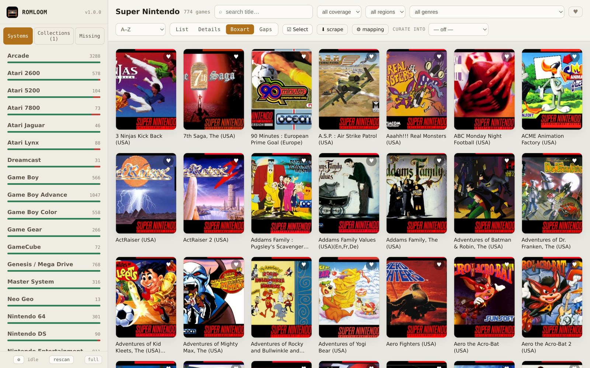
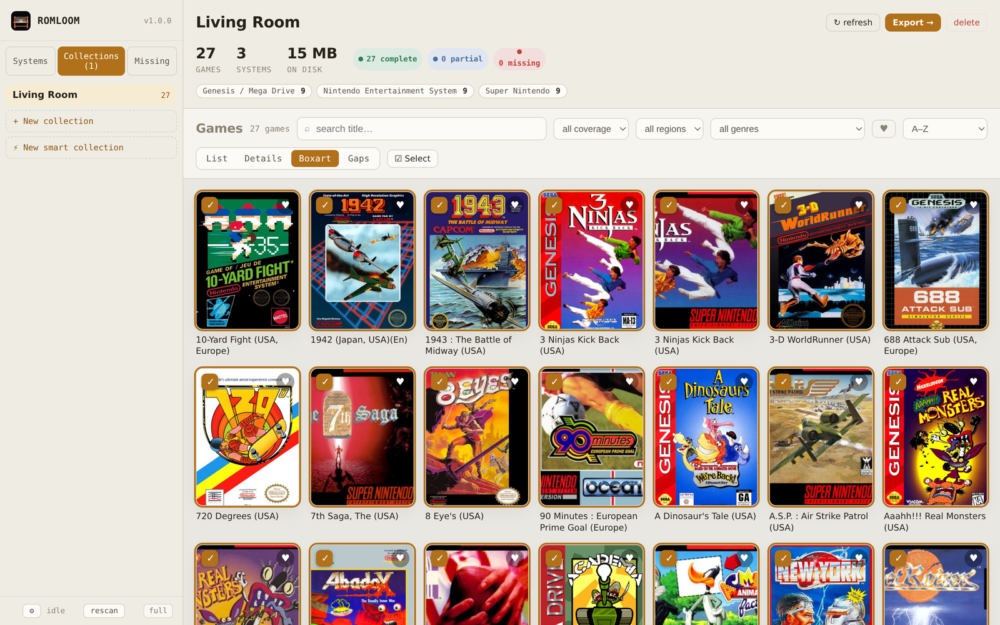
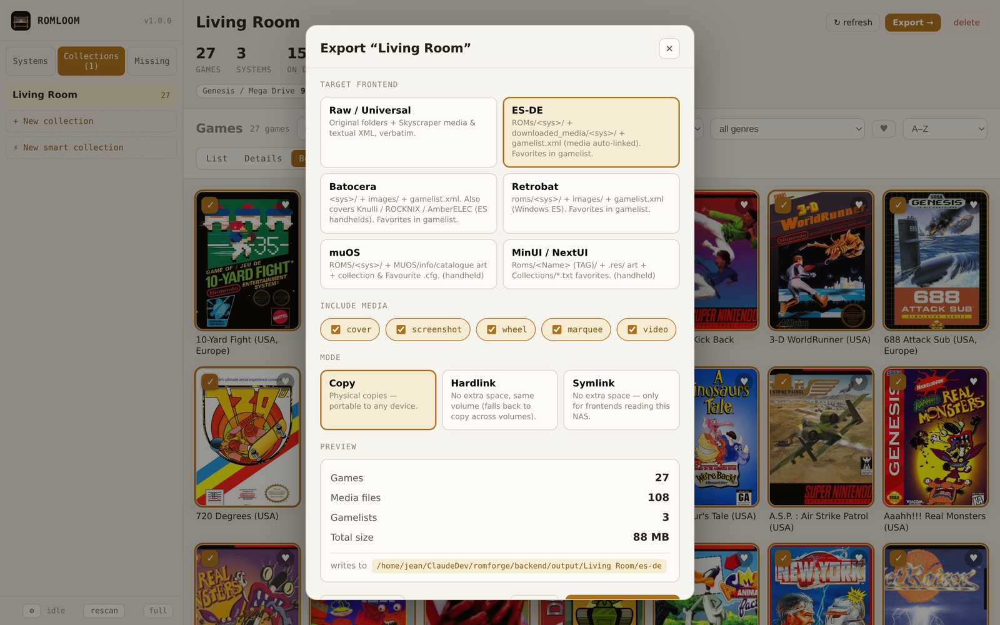
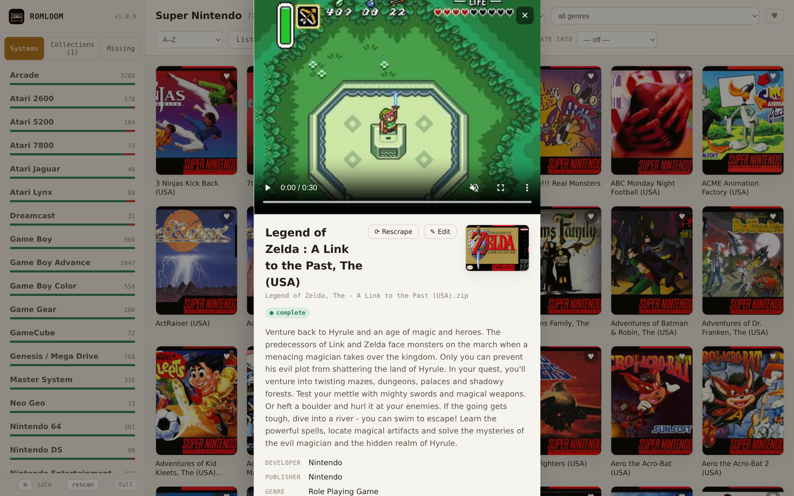

# ROMForge

Self-hosted web app to **browse a scraped ROM library, scrape or hand-fix the
gaps, cherry-pick per-device collections, and export them packaged for any
frontend** — ES-DE, Batocera, Retrobat, or a raw copy. Runs as a single Docker
container on a NAS.



<table>
  <tr>
    <td></td>
    <td></td>
  </tr>
  <tr>
    <td></td>
    <td></td>
  </tr>
</table>

<sub>Gaps view (missing-asset flags) · a curated collection with stats · the per-frontend export dialog · the detail drawer with gameplay video.</sub>

## What works today

- **Per-system library**, one console at a time, with real ROM counts and a
  coverage bar per system.
- **Search** within a system, **filter** by coverage, **region**, **genre**, and
  **favorites**, and **sort** (A–Z, Z–A, favorites-first, your rating, top-rated,
  newest/oldest, least-complete).
- **Four views:** List, Details, Boxart grid, and **Gaps** — name + boxart +
  screenshot + exactly which assets are missing.
- **Make it yours:** mark **favorites** (a heart on every card), set a personal
  **star rating**, a **completion status**, **tags**, and **notes** — all of it
  survives rescans.
- **Infinite scroll** with lazy-loaded images, and **thumbnails pre-generated
  during the scan**, so a 3,000-game boxart wall stays fast without hammering
  the NAS.
- **Game drawer** with full metadata, boxart, an asset checklist, and the
  **gameplay video** (streamed with seek support) when one exists.
- **Built-in scraping** — for a whole system, a single game, or a multi-selection,
  with a live status panel you can **pause / resume / stop / restart**. It picks
  the right source per system automatically: Skyscraper→ScreenScraper for most,
  **GameTDB** for Wii/Wii U (3D box + metadata by GameID), **libretro-thumbnails**
  for Xbox/PS3 art, and **IGDB** for Xbox/360/PS3 text metadata.
- **Manual metadata & art editing** for anything scrapers can't identify (ROM
  hacks, translations, obscure dumps).
- **"Missing ROMs"** view that diffs your library against the complete No-Intro /
  Redump catalogs to show what you're missing.
- **Collections**, both hand-picked and **smart** (rule-based, auto-populated and
  kept current), exported for desktop frontends *and* handhelds (muOS, MinUI,
  Knulli/ROCKNIX/AmberELEC…) with each device's native favorites file.
- **Delete from disk** (single or bulk) and **multi-select** to bulk-add into
  collections.

It understands the real-world quirks of a scraped dump: Skyscraper *and* Skraper
folder layouts, disc games stored as `GameName [ID]/` subfolders, `.cue`+`.bin`
and MAME `.chd` companions, incomplete `.part` downloads, and media named by
region when the ROM is named by id (normalized matching recovers the link).

## Run it on the NAS (Docker)

1. Edit `docker-compose.yml` — point the `/roms` volume at your library and
   `/output` at where collections should land:
   ```yaml
   volumes:
     - /volume1/Plex3/ROMs:/roms          # drop :ro to allow editing/scraping/delete
     - /volume1/Collections:/output
     - ./config:/config
   ```
2. Pull the published image (or `--build` locally):
   ```bash
   docker compose up -d
   ```
   The public image is `ghcr.io/ransierj/romforge:latest`.
3. Open `http://<nas-ip>:8096`, then click **rescan** (bottom-left) to index the
   library. The first scan of a large set over the NAS takes a couple of minutes
   (it also pre-builds thumbnails); after that it's cached in
   `/config/romforge.db`.

   Later rescans are **incremental** — only systems whose folders changed are
   re-read, so adding a few ROMs indexes in about a second. Use **full** (next to
   rescan) after a bulk re-scrape, or after upgrading if indexing changed.

**Read-only vs read-write:** browsing, the Missing view, and exporting only ever
*read* the library, so you can keep `/roms:ro`. The write features — **delete**,
**metadata/art editing**, and **scraping** (which writes art + gamelist back into
the library, exactly where a scraper would) — need the mount read-write, so drop
the `:ro`. Everything else (the SQLite index, thumbnail cache, scrape cache,
settings) lives in `/config` and is never written to your source library.

## Scraping

Scrape a whole system (**⬇ scrape** in the toolbar), a single game (**⟳ Rescrape**
in its drawer), or a multi-selection (**⬇ Rescrape** in the bulk bar). A **status
panel** shows live progress and lets you **pause, resume, stop, or restart**;
stopping keeps whatever already landed. Everything is written **into the library**
(covers, screenshots, metadata) so it flows into exports and survives rescans.

ROMForge chooses the best **source per system** automatically — no per-game
fiddling:

| Source | Systems | Needs | Gets |
| --- | --- | --- | --- |
| **Skyscraper → ScreenScraper** | most consoles | your ScreenScraper login | box/screens/wheels/marquees/video + metadata |
| **GameTDB** | Wii, Wii U | nothing | 3D box + metadata by the GameID in the folder name |
| **libretro-thumbnails** | Xbox, PS3 (+ screenshots for Wii/Wii U) | nothing | box art + screenshots, matched by title |
| **IGDB** | Xbox, Xbox 360, PS3 | free Twitch Client ID + Secret | text metadata (+ cover/screens where missing) |

- **ScreenScraper** games honor a **Preferred region** (Settings) for US / EU / JP
  names *and* box art, so US games don't come back with PAL names ("Starwing" vs
  "Star Fox"); it re-fetches each scrape so a region change applies.
- **GameTDB / libretro / IGDB** are title/GameID-matched and need no ROM hashing —
  the fix for HD disc systems ScreenScraper can't match. GameTDB and libretro are
  **keyless**; IGDB just needs a free Twitch app.
- Credentials live in ⚙ **Settings** (ScreenScraper login, preferred region, IGDB
  Client ID/Secret) and are masked on read.

## Editing & the "Missing ROMs" view

- **Edit** (✎ in the drawer) lets you set a name, description, developer, genre,
  etc. and **upload cover / screenshot art**. It writes a `textual/*.xml` + the
  image into the library — so, unlike a scraper, it works for ROM hacks no
  database knows, and it survives rescans and flows into exports.
- The **Missing** section fetches the authoritative No-Intro (cartridge) and
  Redump (disc) catalogs via the libretro-database mirror and diffs them against
  what's on disk, defaulting to **retail USA** titles. Each missing title has a
  one-click Google search.

## Collections

Curate device-specific sets without touching the library:

- Switch the sidebar to **Collections**, or pick a **curate into** target in the
  library toolbar — checkboxes then appear on every game.
- Tick individual games, use **☑ Select** mode to bulk-add a multi-selection, or
  **Add all N** matching the current system + search + coverage filter.
- **Smart collections** (⚡ *New smart collection*) populate themselves from a
  rule set — systems, genre, region, coverage, favorites, completion status,
  minimum rating, title contains — combined with AND (OR within a multi-value
  field). They re-evaluate on every scan, on **↻ refresh**, and whenever you edit
  the rules, so "all my USA favorites" or "SNES games I've beaten, 4★+" stays
  current on its own.
- The **Collections** page shows a collection's stats (game count, systems, size,
  coverage) and its games in all four views. Click a **system chip** to filter to
  that console; **↻ refresh** re-reads metadata/art from disk (and re-evaluates a
  smart collection's rules) so an export is current; **clean** prunes entries
  whose ROM is no longer in the library.
- Membership is keyed by `(system, rom filename)`, so it **survives rescans**
  even though game rows are rebuilt each scan.

Deep links: `?system=snes&view=Gaps`, `?curate=<id>`,
`?mode=collections&collection=<id>`, `?mode=missing&system=snes`.

## Export

Open a collection and hit **Export →** to physically build it for a target
frontend. Pick which media to include, see a **dry-run preview** (games, media
files, total size, destination), then export with a live progress bar.

Each target is written under `OUTPUT_ROOT/<collection>/<target>/`:

| Target | ROMs | Media | Metadata |
| --- | --- | --- | --- |
| **Raw** | `<System>/<rom>` | `<System>/media/{covers,screenshots,wheels,marquees,textual}/` | textual XML, verbatim |
| **ES-DE** | `ROMs/<sys>/<rom>` | `downloaded_media/<sys>/{covers,screenshots,marquees}/<stem>.png` | `ROMs/<sys>/gamelist.xml` |
| **Batocera** | `<sys>/<rom>` | `<sys>/images/<stem>-{image,thumb,marquee}.png` | `<sys>/gamelist.xml` |
| **Retrobat** | `roms/<sys>/<rom>` | `roms/<sys>/images/<stem>-…` | `roms/<sys>/gamelist.xml` |
| **muOS** | `ROMS/<sys>/<rom>` | `MUOS/info/catalogue/<sys>/{box,preview}/<stem>.png` | collection + `Favourite.cfg` |
| **MinUI / NextUI** | `Roms/<Name> (TAG)/<rom>` | `…/.res/<stem>.png` | `Collections/*.txt` favorites |

- `<sys>` is translated from your folder name via the platform map
  (`Nintendo - Super Nintendo…` → `snes`); edit it per-system with **⚙ mapping**.
- Media is remapped per target, and **gameplay videos** ship when present
  (`video` toggle, on by default).
- **Favorites travel with the export:** ES-family targets (ES-DE, Batocera,
  Retrobat — and therefore Knulli / ROCKNIX / AmberELEC handhelds) mark favorited
  games `<favorite>true</favorite>` in the gamelist; muOS and MinUI get their own
  native favorites/collection files.
- **Disc & arcade companions travel with the game:** a `.cue`/`.gdi` brings its
  `.bin`/`.img` tracks, a MAME romset brings its sibling `.chd` folder, and disc
  games stored as folders are copied whole.
- **Copy / hardlink / symlink** modes: copy is portable; hardlink and symlink use
  near-zero extra space for frontends reading the same NAS.
- Resume-friendly (existing same-size files are skipped), drops a
  `romforge-manifest.json`, and **presets** save a target + media + mode combo
  for one-click repeat exports.

## Configuration

| Variable | Default | Meaning |
| --- | --- | --- |
| `ROMFORGE_ROMS_ROOT` | `/roms` | Source library |
| `ROMFORGE_OUTPUT_ROOT` | `/output` | Where collections are written |
| `ROMFORGE_CONFIG_DIR` | `/config` | SQLite index, thumbnail + scrape cache, settings |
| `ROMFORGE_PORT` | `8096` | HTTP port |

## Layout it expects

```
<ROMS_ROOT>/
  <System Name>/
    Game (USA).zip
    media/
      covers/      Game (USA).png
      screenshots/ Game (USA).png     # or screenshot/
      wheels/      Game (USA).png
      marquees/    Game (USA).png
      videos/      Game (USA).mp4
      textual/     Game (USA).xml      # metadata (or a gamelist.xml fallback)
```

Disc systems may instead store each game as `Game [GAMEID]/GAMEID.wbfs`, and
`.cue`+`.bin` / `.chd` sets are understood.

## Local development

```bash
# backend
cd backend
python -m venv .venv && . .venv/bin/activate
pip install -r requirements.txt
ROMFORGE_ROMS_ROOT=/path/to/ROMs uvicorn app.main:app --reload --port 8096

# frontend (proxies /api to :8096)
cd frontend
npm install
npm run dev      # http://localhost:5173
npm run build    # compiles into ../backend/static for production
```

Note: the built Docker image also compiles Skyscraper (Qt) for the scraper, so
the image is larger (~490 MB) than a pure-Python build; local dev without the
binary simply hides the scrape buttons.

## Stack

FastAPI + SQLite + Pillow, with a bundled Skyscraper plus GameTDB / libretro-
thumbnails / IGDB scraping sources (backend) · React + Vite (frontend) · single
Docker image serving both.
