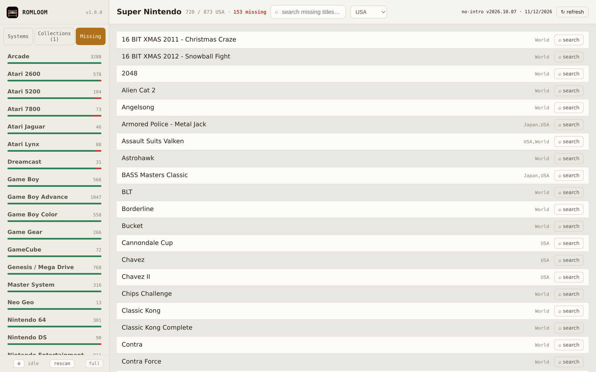

<p align="center">
  
</p>

<h1 align="center">ROMLoom</h1>

<p align="center">
  A self-hosted web app for a scraped ROM library. Browse it, scrape or
  hand-fix the gaps, pick per-device collections, and export them packaged for
  ES-DE, Batocera, Retrobat, handhelds, or a plain copy.<br/>
  It runs as one Docker container on a NAS.
</p>


<table>
  <tr>
    <td></td>
    <td></td>
  </tr>
  <tr>
    <td></td>
    <td></td>
  </tr>
</table>

<sub>A curated multi-system collection with stats · the “Missing ROMs” view diffed against No-Intro/Redump · the per-frontend export dialog with desktop and handheld targets · the detail drawer with gameplay video, metadata, and rescrape/edit.</sub>

## What it does

- A per-system library, one console at a time, with real ROM counts and a
  coverage bar for each system.
- Search within a system. Filter by coverage, region, genre, and favorites.
  Sort A–Z, Z–A, favorites-first, your rating, top-rated, newest, oldest, or
  least-complete.
- Four views: List, Details, Boxart grid, and Gaps. The Gaps view shows name,
  boxart, screenshot, and exactly which assets are missing.
- Per-game curation that survives rescans: favorites (a heart on each card), a
  star rating, a completion status, tags, and notes.
- Infinite scroll with lazy-loaded images. Thumbnails are built during the scan,
  so a 3,000-game boxart wall stays fast and doesn't hammer the NAS on every
  page.
- A game drawer with full metadata, boxart, an asset checklist, and the gameplay
  video (streamed, with seek) when one exists.
- Scraping for a whole system, a single game, or a multi-selection, with a live
  status panel you can pause, resume, stop, or restart. It picks the source per
  system: Skyscraper/ScreenScraper for most consoles, GameTDB for Wii and Wii U
  (3D box plus metadata by GameID), libretro-thumbnails for Xbox and PS3 art, and
  IGDB for Xbox, 360, and PS3 text metadata.
- Manual metadata and art editing for anything a scraper can't identify: ROM
  hacks, translations, obscure dumps.
- A "Missing ROMs" view that diffs your library against the full No-Intro and
  Redump catalogs.
- Collections, hand-picked or smart (rule-based and auto-populated), exported for
  desktop frontends and for handhelds (muOS, MinUI, Knulli, ROCKNIX, AmberELEC)
  with each device's native favorites file.
- Delete from disk, single or bulk, and multi-select to bulk-add into
  collections.

It handles the quirks of a real scraped dump: both Skyscraper and Skraper folder
layouts, disc games stored as `GameName [ID]/` subfolders, `.cue`+`.bin` and MAME
`.chd` companions, incomplete `.part` downloads, and media named by region when
the ROM is named by id. Normalized matching recovers the link in that last case.

## Run it on the NAS (Docker)

1. Edit `docker-compose.yml`. Point the `/roms` volume at your library and
   `/output` at where collections should land:
   ```yaml
   volumes:
     - /volume1/Plex3/ROMs:/roms          # drop :ro to allow editing/scraping/delete
     - /volume1/Collections:/output
     - ./config:/config
   ```
2. Pull the published image (or build locally with `--build`):
   ```bash
   docker compose up -d
   ```
   The public image is `ghcr.io/ransierj/romloom:latest`.
3. Open `http://<nas-ip>:8096` and click rescan (bottom-left) to index the
   library. The first scan of a large set over the NAS takes a couple of minutes,
   since it also pre-builds thumbnails. After that it's cached in
   `/config/romloom.db`.

   Later rescans are incremental. Only systems whose folders changed are re-read,
   so adding a few ROMs indexes in about a second. Use full (next to rescan) after
   a bulk re-scrape, or after an upgrade that changed indexing.

### Read-only vs read-write

Browsing, the Missing view, and exporting only read the library, so you can keep
`/roms:ro`. The write features need the mount read-write, so drop the `:ro` for
those: delete, metadata and art editing, and scraping (which writes art and a
gamelist back into the library, where a scraper would put them). Everything else
lives in `/config` and is never written to your source library: the SQLite index,
the thumbnail cache, the scrape cache, and settings.

## Run without Docker (Windows, macOS, Linux)

On Windows the easiest path is the [packaged build](#windows-bundle) — one `.exe`
with the frontend embedded. To run from source on any OS you need Python 3.12 and
Node (to build the frontend once), plus a native Skyscraper binary if you want
ScreenScraper scraping.

```bash
# build the frontend once (vite outputs into backend/static)
cd frontend
npm ci
npm run build

cd ../backend
python -m venv .venv
. .venv/bin/activate            # Windows: .venv\Scripts\activate
pip install -r requirements.txt

# point it at your library (set these as real paths for your OS)
export ROMLOOM_ROMS_ROOT="/path/to/ROMs"      # Windows: set ROMLOOM_ROMS_ROOT=D:\ROMs
export ROMLOOM_OUTPUT_ROOT="/path/to/Collections"
export ROMLOOM_CONFIG_DIR="/path/to/config"   # index + caches; created if missing

python -m app.main               # serves http://127.0.0.1:8096
```

Set `ROMLOOM_HOST=0.0.0.0` to reach it from other machines on the LAN, and
`ROMLOOM_PORT` to change the port.

### Windows bundle

A standalone `romloom.exe` (no Python or Node install needed) is built by the
**Windows bundle** GitHub Actions workflow. Run it from the repo's Actions tab to
get a downloadable artifact, or push a `v*` tag to attach the exe to a release.
To build it yourself on a Windows machine, run `scripts/build-windows.ps1` (needs
Python 3.12 and Node), which produces `backend/dist/romloom.exe`.

Configure it by putting a `romloom.toml` next to the exe (copy
`backend/romloom.toml.example`):

```toml
roms_root   = "D:\\ROMs"
output_root = "D:\\Collections"
# skyscraper_bin = "C:\\Tools\\Skyscraper\\Skyscraper.exe"  # for ScreenScraper
```

Double-click the exe: it starts the server, opens your browser, and keeps its
index and caches in a `config` folder beside itself. Environment variables still
override anything in the toml.

**Scraping without Docker.** The keyless sources (GameTDB, libretro-thumbnails,
IGDB) need nothing extra and work on every OS. For Skyscraper/ScreenScraper,
install the Skyscraper binary natively:

- **Linux / macOS:** build it from the [Skyscraper](https://github.com/Gemba/skyscraper)
  source (its installer drops `Skyscraper` on your `PATH`), and ROMLoom finds it
  automatically.
- **Windows:** download a Skyscraper Windows build and set
  `ROMLOOM_SKYSCRAPER_BIN` to the full path of `Skyscraper.exe`.

ROMLoom redirects Skyscraper's config and scrape cache into `ROMLOOM_CONFIG_DIR`
(not your home folder), so everything stays together. If the binary isn't found,
the scrape buttons simply don't appear and the rest of the app works normally.

**Platform notes.**
- Scrape pause/resume freezes the Skyscraper process on Linux and macOS. On
  Windows the subprocess can't be frozen, so pause only holds the keyless
  sources; stop still ends a Skyscraper run cleanly.
- Export copy and hardlink modes work everywhere. Symlink mode needs admin or
  Developer Mode on Windows; without it, those files quietly fall back to a copy.

## Scraping

Scrape a whole system (⬇ scrape in the toolbar), a single game (⟳ Rescrape in its
drawer), or a multi-selection (⬇ Rescrape in the bulk bar). A status panel shows
live progress and lets you pause, resume, stop, or restart. Stopping keeps
whatever already landed. Everything is written into the library (covers,
screenshots, metadata), so it flows into exports and survives rescans.

ROMLoom picks the source per system automatically. There's no per-game setup.

| Source | Systems | Needs | Gets |
| --- | --- | --- | --- |
| Skyscraper → ScreenScraper | most consoles | your ScreenScraper login | box/screens/wheels/marquees/video + metadata |
| GameTDB | Wii, Wii U | nothing | 3D box + metadata by the GameID in the folder name |
| libretro-thumbnails | Xbox, PS3 (+ screenshots for Wii/Wii U) | nothing | box art + screenshots, matched by title |
| IGDB | Xbox, Xbox 360, PS3 | free Twitch Client ID + Secret | text metadata (+ cover/screens where missing) |

- ScreenScraper games follow the Preferred region set in Settings for US, EU, or
  JP names and box art. That keeps US games from coming back with PAL names
  ("Starwing" instead of "Star Fox"). It re-fetches on each scrape, so a region
  change takes effect.
- GameTDB, libretro, and IGDB match by title or GameID and don't hash the ROM,
  which is what makes them work for the HD disc systems ScreenScraper can't match.
  GameTDB and libretro need no key; IGDB needs a free Twitch app.
- Credentials live in ⚙ Settings (ScreenScraper login, preferred region, IGDB
  Client ID and Secret) and are masked on read.

## Editing and the "Missing ROMs" view

- Edit (✎ in the drawer) sets name, description, developer, genre, and so on, and
  uploads cover or screenshot art. It writes a `textual/*.xml` plus the image into
  the library. Unlike a scraper, this works for ROM hacks no database knows, and
  it survives rescans and flows into exports.
- The Missing section pulls the No-Intro (cartridge) and Redump (disc) catalogs
  via the libretro-database mirror and diffs them against what's on disk. It
  defaults to retail USA titles. Each missing title has a one-click Google search.

## Collections

Build device-specific sets without touching the library:

- Switch the sidebar to Collections, or pick a "curate into" target in the library
  toolbar. Checkboxes then appear on every game.
- Tick individual games, use ☑ Select mode to bulk-add a multi-selection, or
  Add all N matching the current system, search, and coverage filter.
- Smart collections (⚡ New smart collection) populate themselves from a rule set:
  systems, genre, region, coverage, favorites, completion status, minimum rating,
  and title-contains, combined with AND (OR within a multi-value field). They
  re-evaluate on every scan, on ↻ refresh, and whenever you edit the rules, so
  "all my USA favorites" or "SNES games I've beaten, 4★+" stays current on its own.
- The Collections page shows a collection's stats (game count, systems, size,
  coverage) and its games in all four views. Click a system chip to filter to that
  console. ↻ refresh re-reads metadata and art from disk (and re-evaluates a smart
  collection's rules) so an export is current. clean prunes entries whose ROM is
  no longer in the library.
- Membership is keyed by `(system, rom filename)`, so it survives rescans even
  though game rows are rebuilt each scan.

Deep links: `?system=snes&view=Gaps`, `?curate=<id>`,
`?mode=collections&collection=<id>`, `?mode=missing&system=snes`.

## Export

Open a collection and hit Export → to build it for a target frontend. Pick which
media to include, check the dry-run preview (games, media files, total size,
destination), then export with a live progress bar.

Each target is written under `OUTPUT_ROOT/<collection>/<target>/`:

| Target | ROMs | Media | Metadata |
| --- | --- | --- | --- |
| Raw | `<System>/<rom>` | `<System>/media/{covers,screenshots,wheels,marquees,textual}/` | textual XML, verbatim |
| ES-DE | `ROMs/<sys>/<rom>` | `downloaded_media/<sys>/{covers,screenshots,marquees}/<stem>.png` | `ROMs/<sys>/gamelist.xml` |
| Batocera | `<sys>/<rom>` | `<sys>/images/<stem>-{image,thumb,marquee}.png` | `<sys>/gamelist.xml` |
| Retrobat | `roms/<sys>/<rom>` | `roms/<sys>/images/<stem>-…` | `roms/<sys>/gamelist.xml` |
| muOS | `ROMS/<sys>/<rom>` | `MUOS/info/catalogue/<sys>/{box,preview}/<stem>.png` | collection + `Favourite.cfg` |
| MinUI / NextUI | `Roms/<Name> (TAG)/<rom>` | `…/.res/<stem>.png` | `Collections/*.txt` favorites |

- `<sys>` is translated from your folder name via the platform map
  (`Nintendo - Super Nintendo…` → `snes`). Edit it per-system with ⚙ mapping.
- Media is remapped per target. Gameplay videos ship when present (video toggle,
  on by default).
- Favorites travel with the export. ES-family targets (ES-DE, Batocera, Retrobat,
  and therefore Knulli, ROCKNIX, and AmberELEC handhelds) mark favorited games
  `<favorite>true</favorite>` in the gamelist. muOS and MinUI get their own native
  favorites and collection files.
- Disc and arcade companions travel with the game. A `.cue`/`.gdi` brings its
  `.bin`/`.img` tracks, a MAME romset brings its sibling `.chd` folder, and disc
  games stored as folders are copied whole.
- Copy, hardlink, or symlink. Copy is portable. Hardlink and symlink use near-zero
  extra space for frontends reading the same NAS.
- Exports are resume-friendly (existing same-size files are skipped), drop a
  `romloom-manifest.json`, and support presets that save a target, media, and mode
  combo for one-click repeat exports.

## Configuration

| Variable | Default | Meaning |
| --- | --- | --- |
| `ROMLOOM_ROMS_ROOT` | `/roms` | Source library |
| `ROMLOOM_OUTPUT_ROOT` | `/output` | Where collections are written |
| `ROMLOOM_CONFIG_DIR` | `/config` | SQLite index, thumbnail and scrape cache, settings |
| `ROMLOOM_HOST` | `127.0.0.1` | Interface to bind (Docker's CMD overrides this to `0.0.0.0`) |
| `ROMLOOM_PORT` | `8096` | HTTP port |
| `ROMLOOM_SKYSCRAPER_BIN` | _(auto)_ | Path to a native Skyscraper binary; auto-detected on `PATH` when unset |

## Layout it expects

```
<ROMS_ROOT>/
  <System Name>/
    Game (USA).zip
    media/
      covers/      Game (USA).png
      screenshots/ Game (USA).png     # or screenshot/
      wheels/      Game (USA).png
      marquees/    Game (USA).png
      videos/      Game (USA).mp4
      textual/     Game (USA).xml      # metadata (or a gamelist.xml fallback)
```

Disc systems may instead store each game as `Game [GAMEID]/GAMEID.wbfs`.
`.cue`+`.bin` and `.chd` sets are understood.

## Local development

```bash
# backend
cd backend
python -m venv .venv && . .venv/bin/activate
pip install -r requirements.txt
ROMLOOM_ROMS_ROOT=/path/to/ROMs uvicorn app.main:app --reload --port 8096

# frontend (proxies /api to :8096)
cd frontend
npm install
npm run dev      # http://localhost:5173
npm run build    # compiles into ../backend/static for production
```

The Docker image also compiles Skyscraper (Qt) for the scraper, so it's larger
(~490 MB) than a pure-Python build. Local dev without the binary just hides the
scrape buttons.

## Stack

FastAPI, SQLite, and Pillow on the backend, with a bundled Skyscraper plus
GameTDB, libretro-thumbnails, and IGDB scraping sources. React and Vite on the
frontend. A single Docker image serves both.
